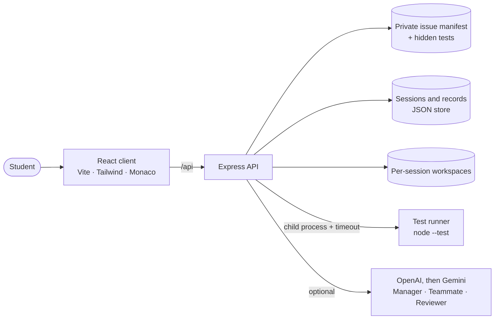

<div align="center">

# OnWard

**Do the job before you get the job.**

An AI engineering-job simulation. Students get a real ticket, work inside a real codebase,
collaborate with an AI team, and earn a work record that anyone can verify.

Built for **wHACKiest 2026** · Track 4: **UnlockED**

</div>

---

## The problem

Graduates are hired for jobs they have never seen. Courses teach syntax and algorithms, but the
first week on a real team is about reading unfamiliar code, understanding a vague ticket,
knowing when to ask for help, and proving a fix works. Recruiters cannot see any of that on a
resume, and a certificate only proves attendance.

## What OnWard does

| Step | What the student does | Who helps |
|---|---|---|
| 1. Briefing | Reads a ticket and asks clarifying questions | **AI Engineering Manager** writes the ticket and answers requirement questions, never the solution |
| 2. Codespace | Reads, edits and tests a working codebase in a browser editor: one of 4 frontend apps or 4 backend services | **AI Teammate** guides with questions and four levels of hints |
| 3. Review | Submits the change | **Hidden acceptance tests** decide the result; **AI Reviewer** explains the change and rates code quality |
| 4. Record | Shares a **Verified Work Record** with a QR code | The record is HMAC-signed, so any edit breaks verification |
| 5. Profile | Sees a day streak, an activity grid, totals and every past ticket | Created on first start (name, email, role); kept in the browser, no password |

Students pick a role when they start. There are 40 tickets: 20 frontend tickets across four apps
(Pulsewave music player, Nestly home rentals, TaskFlow kanban board, MediTrack clinic booking) and 20
backend tickets across four services (ShopSphere store, Ledgerly expense splitting, Ridewise ride
hailing, Libris library lending), each codebase with five different bugs at easy, medium and hard.

The record shows *how* the student worked, not just the result: tests passed, hint level used,
questions asked, test runs and time spent.

## Design principles

- **Tests decide, AI explains.** Pass or fail comes from deterministic tests, never from a model.
- **AI roles have boundaries.** Each role sees only what it needs. The Teammate never sees the
  answer, and no role sees the hidden tests. See [docs/ai-roles.md](docs/ai-roles.md).
- **Works without AI.** Every AI call has a deterministic fallback, so the product runs with no API
  key and survives model outages.
- **Student code is isolated.** It runs in a separate process, in a temporary copy, with a timeout
  and no secrets. See [docs/security.md](docs/security.md).

## Architecture



More detail in [docs/architecture.md](docs/architecture.md).

## Tech stack

| Layer | Tools |
|---|---|
| Client | React 19, Vite, Tailwind CSS 4, Monaco Editor, React Router, lucide-react |
| Server | Node.js 24+, Express 5, zod, express-rate-limit |
| AI | OpenAI via `openai`, then Google Gemini via `@google/genai` (both optional) |
| Testing | Node's built-in test runner (`node:test`) |

## Getting started

**Requirements:** Node.js 24 or newer.

```bash
git clone <repository-url> onward
cd onward
npm run setup          # installs server, client and simulation dependencies
cp server/.env.example server/.env
npm run dev            # API on :5050, web app on http://localhost:5173
```

Live AI is optional. Set `OPENAI_API_KEY` (and `OPENAI_MODEL` if you want a different model) and/or
`GEMINI_API_KEY` in `server/.env`. OpenAI is tried first, then Gemini (and the models in
`GEMINI_FALLBACK_MODELS`). Without a key, or while both are busy, every colleague answers from a prepared
question bank: ten questions for the manager and seven or eight per teammate, each with its own answer
built from the ticket.

### Running tests

```bash
npm test               # server tests + every simulation's project tests
```

## Deployment

The web client and the API deploy separately.

**API on [Render](https://render.com)** (it keeps a server running and can start child processes
for test runs, which serverless hosts cannot):

1. New → Blueprint → pick this repository. Render reads [`render.yaml`](render.yaml).
2. Set `CLIENT_ORIGIN` to the Vercel address of the web client, and `OPENAI_API_KEY` and/or
   `GEMINI_API_KEY` if you have them.
   `RECORD_SECRET` is generated for you.
   `DEMO_MODE=true` adds a Solution (demo) panel to the Codespace that loads each ticket's
   predefined fix, for live demos. Set it to `false` for real use.

**Web client on [Vercel](https://vercel.com):**

1. Add New → Project → pick this repository, and set the root directory to `client`.
2. Add the environment variable `VITE_API_BASE_URL` with the Render address of the API,
   e.g. `https://onward-api.onrender.com`. Vercel reads [`client/vercel.json`](client/vercel.json).

On Render's free plan the server sleeps when idle and its disk is temporary, so sessions and records
reset when it restarts. Attach a persistent disk and point `DATA_DIRECTORY` at it to keep them.

## Project structure

```
onward/
├── client/                    React web app
│   └── src/
│       ├── api/               every network call lives here
│       ├── components/        shared UI (buttons, cards, chat panel, layout)
│       ├── features/          one folder per page: landing, briefing, codespace, review, record
│       ├── hooks/             shared React hooks
│       └── lib/               constants and helpers
├── server/                    Express API
│   ├── private/               issue manifests and hidden tests (never sent to students)
│   ├── src/
│   │   ├── config/            environment validation
│   │   ├── routes/            URL → controller mapping
│   │   ├── controllers/       HTTP in, HTTP out, no business rules
│   │   ├── services/          business logic, including services/ai for the three AI roles
│   │   ├── prompts/           prompt templates as Markdown files
│   │   ├── schemas/           zod schemas for requests and AI output
│   │   ├── middleware/        validation, rate limits, error handling
│   │   └── store/             JSON-file persistence (swappable for a database)
│   └── tests/                 unit and API tests
├── simulations/
│   ├── pulsewave/ nestly/ taskflow/ meditrack/    frontend apps (vanilla JS)
│   └── shopsphere/ ledgerly/ ridewise/ libris/    backend services (Node)
├── docs/                      architecture, AI roles, API and security notes
└── scripts/                   developer scripts
```

## Documentation

- [Architecture](docs/architecture.md): request flow, session lifecycle, scoring
- [AI roles](docs/ai-roles.md): what each AI role can and cannot see
- [API reference](docs/api.md): every endpoint with examples
- [Security](docs/security.md): secrets, sandboxing and known limits

## Roadmap

- More roles: Frontend Developer, Data Analyst, DevOps Engineer
- More simulations and a contributor guide for adding issues
- Database storage and student accounts
- Stronger sandboxing (containers) for student code
- College dashboards to run cohort-wide virtual internships

## License

[MIT](LICENSE)
