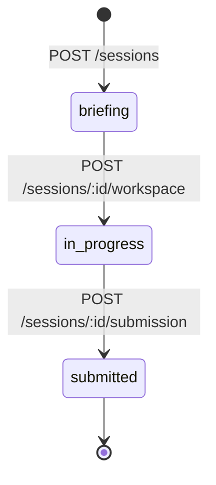
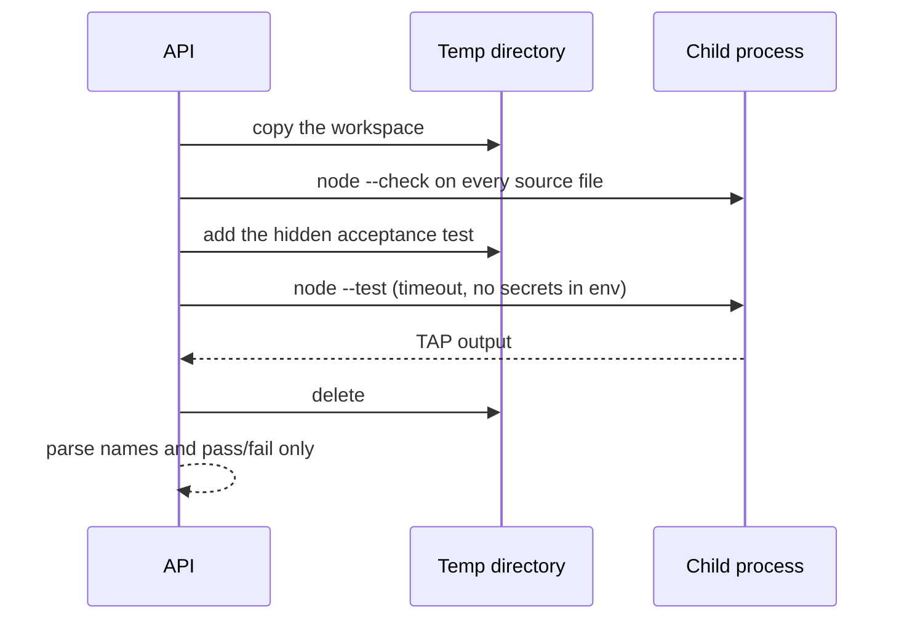

# Architecture

OnWard has three parts:

| Part | Folder | Responsibility |
|---|---|---|
| Client | `client/` | The student-facing web app |
| Server | `server/` | Sessions, workspaces, test runs, AI roles, work records |
| Simulations | `simulations/` | Codebases students work on: four frontend apps and four backend services |

## Server layers

Requests flow through the layers in one direction:

```
route → middleware (validation, rate limit) → controller → service → store / file system / OpenAI or Gemini
```

- **Routes** map URLs to controllers and attach middleware.
- **Controllers** read validated input from `req.valid`, call a service and shape the JSON response.
  They contain no business rules.
- **Services** hold all business logic. AI roles live in `services/ai/`.
- **Store** persists sessions and records as JSON files. It exposes `get` and `save` only, so it can be
  replaced by a database adapter without changing the services.

Every error response has the same shape:

```json
{ "error": { "code": "SESSION_NOT_FOUND", "message": "This session does not exist." } }
```

## Session lifecycle



1. **Create.** The server picks a codebase for the chosen role and an issue of the chosen difficulty
   from its private manifest. The
   AI Manager writes the ticket from the issue's public fields.
2. **Start work.** That codebase is copied into a workspace folder for this session.
3. **Work.** In the Codespace the student reads and edits files, runs tests, asks the teammates and can request
   reviews, improving the work between them.
4. **Submit.** Tests run one final time, a diff is computed against the original project, the Reviewer
   rates the change, a score is calculated and a signed Work Record is issued.

## Test runs



Hidden tests are prefixed with `[acceptance]`, so results can be grouped into *acceptance checks* (from
the ticket) and *project tests* (existing behaviour that must not break).

## Scoring

| Part | Points | Rule |
|---|---|---|
| Correctness | 60 | Awarded only when every project test and acceptance check passes |
| Code quality | 25 | The Reviewer's quality score (fallback: rule-based) |
| Independence | 15 | Resolved tickets only: 15 / 12 / 8 / 4 / 0 for hint levels 0 to 4 |

An unresolved ticket can never score more than 25. The logic is in
`server/src/services/scoring.service.js` and is covered by unit tests.

## Work Records

A record contains the student's name, the task, the outcome, test counts, score, process metrics
and the review summary. The server signs the record with HMAC-SHA256 over a canonical JSON form (keys
sorted) using `RECORD_SECRET`. `GET /api/records/:id` recomputes the signature and returns
`verified: true` only if nothing has changed.
